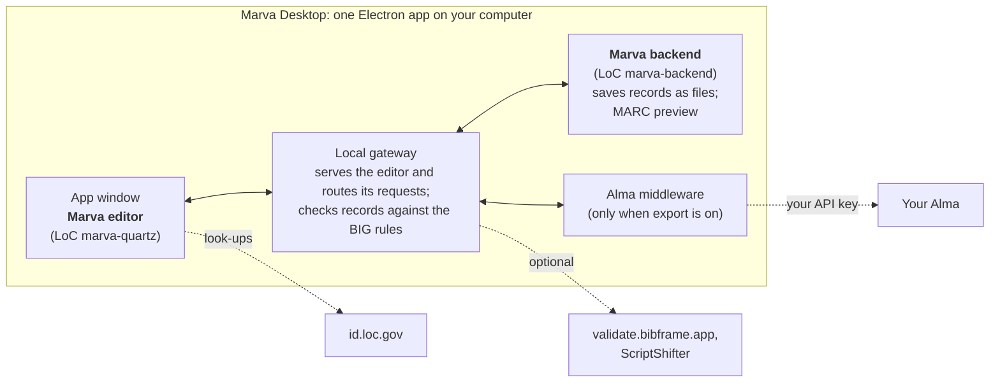

# Marva Desktop

Installers for **Marva Desktop**, a desktop build of the Library of Congress's [Marva](https://github.com/lcnetdev/marva-quartz) BIBFRAME editor. It runs on your own computer, with LoC's editor backend running alongside it, and can optionally send records to your library system (Alma).

**Status: release candidate 1.0.0-rc.1, for testing.**

## Download

Get the installer for your computer from the [Releases](https://github.com/jimfhahn/marva-desktop-releases/releases) page:

| Computer | File |
|---|---|
| Mac with Apple silicon (M1 or later) | `.dmg` |
| Windows (64-bit) | `Setup … .exe` |
| Linux (64-bit) | `.AppImage` |

The installers are signed (and notarized on macOS). Each release lists their checksums in `SHA256SUMS`. Installed copies update themselves from published releases.

## Problems and questions

- **Bugs and questions:** open an issue on the [Issues](https://github.com/jimfhahn/marva-desktop-releases/issues) page. Say which computer and which version (Marva → About Marva Desktop on a Mac; Help → About on Windows and Linux) you're using.
- **Security problems:** please don't open a public issue. Use **Report a vulnerability** on the [Security](https://github.com/jimfhahn/marva-desktop-releases/security) tab instead.

When testing export to Alma, please use an Alma **Sandbox** key, not a production key.

## How it is put together

Marva Desktop packages the two halves of the Library of Congress's Marva, the editor that runs in the browser and the backend server it talks to, into one app. Everything runs on your own computer and listens only on `127.0.0.1`, so other computers can't reach it.

- **Editor:** LoC's Marva editor, built once and shown in the app's window. It loads from the local gateway, not from loc.gov.
- **Backend:** LoC's marva-backend, run by the app as a separate process. Records are saved as files in your user folder; LoC's database server isn't needed. The backend's links to LoC's own systems (sign-on, publishing to LoC) are switched off.
- **Gateway:** a small local web server inside the app. It serves the editor, passes its requests to the backend, and refuses requests that don't come from the app's window.
- **Validation** runs on your computer by default, using the same BIG rules as validate.bibframe.app. Settings can switch it to the online service.
- **Alma middleware** runs only if you turn on export to Alma in Settings. Your Alma API key is stored by your operating system's keychain and is sent only to Alma.

Dotted lines are the only connections that leave your computer.

## Credits and licences

Marva Desktop is a community build. It is **not affiliated with or endorsed by the Library of Congress**, nor by Ex Libris or Clarivate (Alma is a trademark of Ex Libris Ltd.).

It is built on:

- [Marva](https://github.com/lcnetdev/marva-quartz), the Library of Congress's BIBFRAME editor (version 1.8.0, CC0 1.0), with its [profiles](https://github.com/lcnetdev/marva-profiles) (CC0 1.0).
- [marva-backend](https://github.com/lcnetdev/marva-backend), the Library of Congress's server for Marva (a US Government work, in the public domain).
- The BIG DCTAP rules and LoC's MARC-to-BIBFRAME crosswalk, as used by validate.bibframe.app (CC0 1.0).

What the desktop build adds or changes: running on your own computer with records saved locally; a Settings window (your organization, cataloger and library system); validation on your computer; optional export to Alma; Library of Congress search with results grouped under their Hubs; MARC and BIBFRAME downloads; and usability changes to the editor. LoC's code is changed as little as possible; most additions are separate modules.

The packages the app includes are listed with their licences in `THIRD_PARTY_LICENSES.md`, inside the app's resources.

## Licence

CC0 1.0 Universal.
